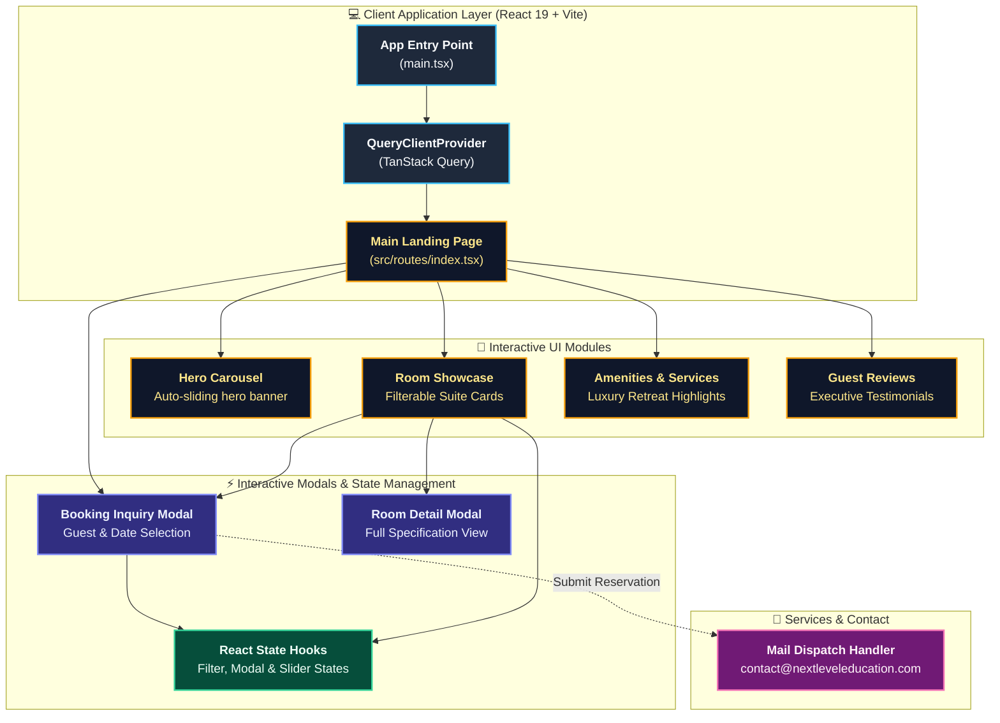
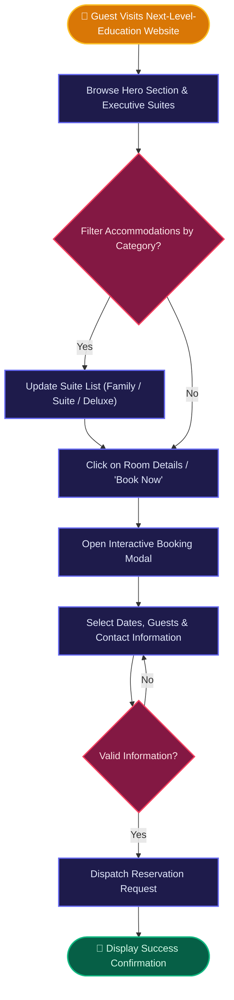
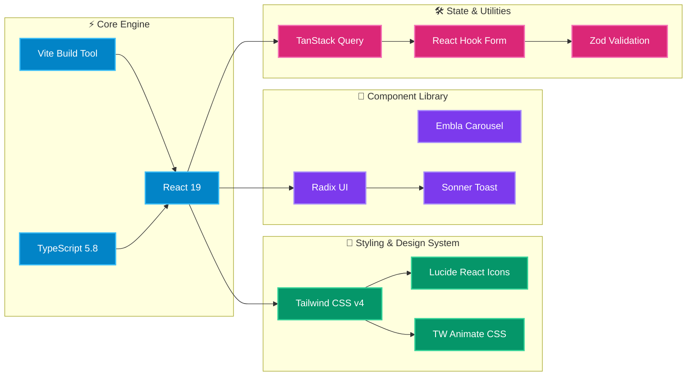

# 🎓 Next-Level-Education — Luxury Hospitality & Executive Retreats

<div align="center">


### 🌟 Experience Unmatched Executive Opulence, World-Class Learning Retreats & Hospitality

[](https://react.dev/)
[](https://www.typescriptlang.org/)
[](https://vitejs.dev/)
[](https://tailwindcss.com/)
[](LICENSE)

</div>

---

## 📌 Project Overview

**Next-Level-Education** is a premier, high-end web application crafted for executive retreats, leadership symposiums, and luxury hospitality. Designed with a sleek gold-and-obsidian visual identity, pixel-perfect responsiveness, and smooth micro-animations, it offers guests and executives an immersive digital preview of world-class accommodations, conference suites, fine dining, spa wellness, and instant reservation workflows.

---

## ✨ Key Features

- 🏛️ **Executive Suite & Room Showcase**: Filter suites and rooms by category (Deluxe, Family, Executive Suite), view capacity, floor plans, high-resolution galleries, and specialized amenities.
- 📅 **Interactive Reservation System**: Comprehensive booking modal with live guest counters, date pickers, room preferences, and direct email dispatch.
- 🌊 **Wellness & Retreat Amenities**: Curated executive wellness experiences including infinity pools, fitness centers, gourmet dining, and private concierge services.
- 🎠 **Dynamic Hero & Review Carousels**: Automated sliders showcasing retreat facilities and real testimonials from past executives and guests.
- 📱 **Responsive & Accessible**: Optimized for mobile, tablet, and desktop viewports with WCAG-compliant contrast and fluid animations.

---

## 🎨 System Diagrams & Architecture

Below are visual diagrams illustrating the system architecture, guest booking journey, and tech stack composition using customized **Mermaid diagrams**.

### 1. 🏗️ High-Level System Architecture



---

### 2. 🔄 Guest Booking & Interaction Flow



---

### 3. 🛠️ Tech Stack & Library Ecosystem



---

## 📁 Project Structure

```text
next-level-education/
├── 📁 src/
│   ├── 📁 components/      # UI components & Radix primitives
│   │   └── 📁 ui/          # Accordion, Dialog, Buttons, Cards, etc.
│   ├── 📁 hooks/           # Custom React Hooks
│   ├── 📁 lib/             # Utility functions & classname mergers (clsx, tailwind-merge)
│   ├── 📁 routes/          # Page routes (index.tsx main landing view)
│   ├── 📄 main.tsx         # Application entry point with QueryClientProvider
│   └── 📄 styles.css       # Global design tokens, keyframes, and Tailwind styles
├── 📄 index.html           # HTML Entry template with Next-Level-Education metadata
├── 📄 vite.config.ts       # Vite build setup & aliases
├── 📄 tsconfig.json        # TypeScript configuration
├── 📄 package.json         # Project dependencies & npm scripts
└── 📄 README.md            # Comprehensive project documentation
```

---

## 🚀 Quick Start & Installation

Follow these steps to run **Next-Level-Education** locally on your machine:

### Prerequisites

- Node.js (v18.x or higher)
- NPM, PNPM, Yarn, or Bun

### 1. Clone the repository

```bash
git clone https://github.com/your-username/next-level-education.git
cd next-level-education
```

### 2. Install Dependencies

Using **NPM**:
```bash
npm install
```

*Or using **Bun** / **PNPM** / **Yarn**:*
```bash
bun install
# or
pnpm install
```

### 3. Development Server

Start the local development server with instant Hot Module Replacement (HMR):

```bash
npm run dev
# or
bun run dev
```

Open your browser and navigate to **`http://localhost:5173`** (or the port specified in terminal).

---

## ⚙️ Available Scripts

In the project directory, you can run:

| Command | Description |
| :--- | :--- |
| `npm run dev` | Starts the Vite development server |
| `npm run build` | Compiles TypeScript and builds production bundle into `dist/` |
| `npm run preview` | Previews the production build locally |
| `npm run lint` | Runs ESLint to check for code quality and syntax issues |
| `npm run format` | Formats codebase using Prettier |

---

## 📞 Contact Details

Reach out to our executive concierge, reservations, or administrative support team:

### Primary Contact Details
- **Email (General Inquiries)**: [contact@nextleveleducation.com](mailto:contact@nextleveleducation.com)
- **Phone (Primary Concierge)**: [+1 (555) 234-5678](tel:+15552345678)
- **Main Campus & Headquarters**: 450 Innovation Parkway, Suite 100, New York, NY 10001

### Alternative Contact Details
- **Email (Alternative / Support & Admissions)**: [support@nextleveleducation.com](mailto:support@nextleveleducation.com)
- **Phone (Alternative Line)**: [+1 (555) 876-5432](tel:+15558765432)
- **Alternative Retreat Facility**: 789 Executive Summit Way, Aspen, CO 81611

---

<div align="center">
  <sub>Crafted with ❤️ and Precision for Next-Level-Education</sub>
</div>
